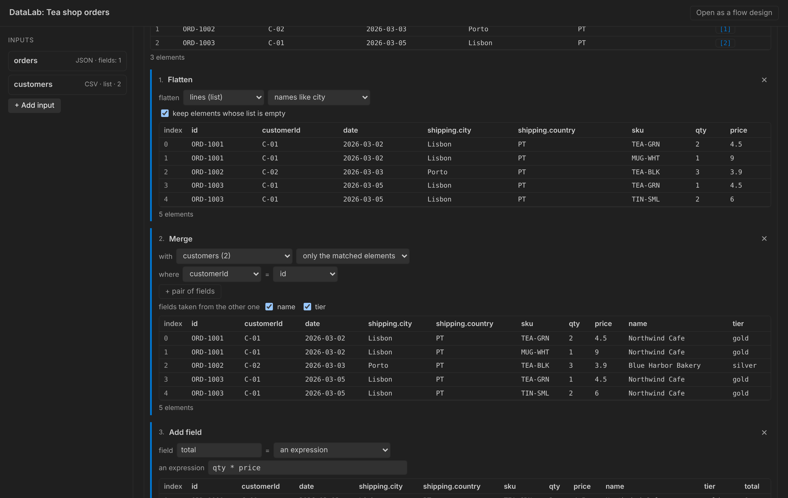

# DataLab

Visual data transformation and exploration directly in VS Code.

DataLab is a visual workspace for exploring, comparing, and transforming
structured data without writing code.

Paste data or load files, build transformations step by step, and instantly
inspect the results in interactive tables. Combine multiple data sources, apply
filters, manipulate fields, and experiment with different transformations in
one workspace.

All data is processed locally. See the [Security Policy](SECURITY.md) for
details.



## Features

- **Visual transformations**: Build data transformations step by step using an
  interactive interface.
- **Multiple input formats**: Work with JSON, XML, YAML, CSV, TSV, and
  key-value data.
- **Multiple data sources**: Load different inputs and use them together in
  transformations.
- **Interactive data exploration**: Navigate nested structures and inspect data
  in tables.
- **Step-by-step previews**: See the results of individual transformation
  steps.
- **Data comparison**: Compare lists and merge data from different sources.
- **Flexible field operations**: Filter, sort, flatten, rename, calculate, and
  modify values.
- **Multiple output formats**: Export transformed results as JSON, XML, YAML,
  CSV, or properties.
- **Logic Spec integration**: Open lab data in Logic Spec for flow design.

## Installation

DataLab requires Visual Studio Code 1.80 or later.

To install from a `.vsix` package:

1. Open VS Code.
2. Go to **Extensions**.
3. Select **… → Install from VSIX…**.
4. Choose the DataLab `.vsix` file.

The interface is available in English.

## Getting Started

### 1. Create a Lab

Open the Command Palette and run:

```text
DataLab: Open a Lab
```

Enter a name to create a new lab, or select an existing one.

You can also delete existing labs from the selection menu.

Each lab is saved as a `<name>.lab.json` file, so it can be committed with the
project. The folder is chosen in this order:

1. **DataLab: Labs Folder** (`dataLab.labsFolder`), if set. A relative path is
   resolved against the workspace; an absolute path is used as it is.
2. The `data` folder of the Spec Studio package (`<workspace name>-spec/data`),
   when Spec Studio is installed and the package folder exists. Turn this off
   with **DataLab: Use Spec Package** (`dataLab.useSpecPackage`).
3. The `data` folder of the workspace.

Without an open folder and without an absolute path, labs are kept in the
extension's own storage.

### 2. Add Data Sources

Add one or more inputs to your lab.

You can paste sample data directly into the editor or load data from a file.

DataLab supports the following formats:

| Format | Supported structures |
|---|---|
| JSON | Objects, arrays, and primitive values |
| XML | Elements and attributes, including repeated elements represented as lists |
| YAML | Mappings and sequences |
| CSV / TSV | Tabular data with a header row |
| Key-value | `.properties` files and query strings, including nested fields defined by dotted keys |

DataLab automatically recognizes supported formats when possible. You can also
select the format manually.

Each input displays its name, format, and size.

Select an input to inspect its content and explore the parsed data in an
interactive preview table.

### 3. Build Transformations

Choose the data you want to transform.

You can start from:

- A list, object, or single value in any input.
- A nested structure within an input.
- The named result of a previous transformation.

Add operations one step at a time. Available operations automatically adapt to
the current data type.

Each step provides a preview, allowing you to inspect how the data changes
throughout the transformation.

## Transformation Operations

### List Operations

| Operation | Description |
|---|---|
| Filter | Keep elements matching specified conditions |
| Sort | Order elements by selected fields |
| Remove duplicates | Eliminate duplicate elements |
| Reverse | Reverse the element order |
| Merge | Combine data with another list or object using matching fields |
| Compare | Compare elements with another list |
| Append | Add elements from another list |
| Select columns | Keep only selected fields |
| Remove columns | Exclude selected fields |
| Flatten | Expand nested structures |
| Change column | Modify values in an existing field |
| Add field | Create a new field |
| Skip / Take | Skip elements or keep the first elements |

Lists can also be reduced to a single value:

- First or last element
- Element at a specified index
- Count
- Sum
- Minimum or maximum
- Average
- Values joined into text

### Object Operations

| Operation | Description |
|---|---|
| Merge | Combine an object with another object or list |
| Select fields | Keep specified fields |
| Remove fields | Exclude specified fields |
| Flatten | Move nested fields to the parent level |
| Change field | Modify an existing field |
| Add field | Create a new field |
| Get field | Extract a field value |
| Convert to list | Wrap the object in a single-element list |

### Field Transformations

Create or modify fields using:

- **Static values**: Assign a fixed value.
- **Field references**: Copy a value from another field.
- **Value transformations**: Apply one or more operations to a field.
- **Text composition**: Combine fields and text.
- **Cross-input references**: Retrieve values from another data source.
- **Expressions**: Calculate values using mathematical expressions and
  supported functions.

Example:

```text
price * quantity - coalesce(discount, 0)
```

### Flattening Nested Data

Flattening simplifies nested structures.

For nested objects, fields are moved one level up.

Field names can retain their parent prefix (`address_city`) or use their
original name (`city`).

For nested lists, each item becomes a separate element, with the parent fields
repeated.

## Interactive Data Explorer

DataLab displays structured data in interactive tables, making it easier to
inspect complex inputs and transformation results.

- Nested object fields appear as columns using dot notation, such as
  `address.city`.
- Nested lists display their element count, such as `[3]`.
- Clicking a nested list opens it in a separate table.
- Elements are indexed starting from 0.

This allows you to explore nested structures without manually navigating raw
JSON, XML, or YAML.

## Results and Export

Inspect the final result of your transformation and choose an output format:

- JSON
- XML
- YAML
- CSV
- Properties

CSV output follows the structure displayed in the result table.

Select **Open in editor** to open the generated result in a new VS Code editor
tab.

## Logic Spec Integration

DataLab can work alongside the Logic Spec extension.

Select **Open as a flow design** to open your lab's flow design in Logic Spec,
including the lab inputs and their data.

Transformation steps can then be copied into a flow.

**Requirement:** The Logic Spec extension must be installed.

## Links

- [Changelog](CHANGELOG.md)
- [Report an Issue](https://github.com/Beata-Humeniuk/data-lab/issues)
- [Security Policy](SECURITY.md)
- [License](LICENSE)
