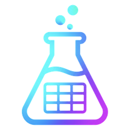

# DataLab

Sample data in any format and its transformations, step by step, with the
result of every step as a table — to work out what to do with data before
it goes into a flow.

**DataLab: Otwórz laboratorium** (*DataLab: Open a lab*) picks a lab or
creates one by the name typed. A lab is kept in the extension's own storage,
never in the project.

On the left the inputs as names only (format, size); a click opens the
input in full — the data pasted or loaded (JSON, XML, YAML, CSV,
key=value), the format, and its preview as a table. On the right the
transformations: pick what to transform — a list (`umowy › Umowa (4)`), an
object (an input whole, an object in it) or a field; it shows as a table —
then add steps with one button each, the result of every step as a table
right under it: **Filtruj** (column, operator, value; all / any of the
conditions), **Sortuj**, **Bez powtórzeń** (by a column or the whole
element), **Odwróć kolejność**, **Połącz z listą / obiektem** (each element with the
fields of its match in another list, by pairs of fields; only the matched
elements or all; which fields to take; a field both have comes in as
`<field>_<list>`; with an object — its fields in every element),
**Dołącz elementy listy** (another list's elements appended),
**Porównaj z listą** (keep those with / with
no match in another input or result, or attach the match — by pairs of
columns), **Wybierz kolumny** (and rename), **Usuń kolumny** (nested ones too), **Zmień kolumnę** (every way of
the "+ ƒ" list that works on a value), **Pomiń / Zostaw pierwsze**; or take
**Pierwszy**, **Ostatni**, **Element o indeksie** (from 0, as the tables number the elements), **Ile**, **Suma**, **Najmniejszy**,
**Największy**, **Średnia**, **Połącz w tekst**. An object takes **Połącz z obiektem / listą** (another object's fields, or
the element of a list its pairs match), **Wybierz
pola**, **Usuń pola**, **Zmień pole**, **Dodaj pole** (on a list too: a fixed
value, another field, a field transformed by the "+ ƒ" ways one after
another, fields and texts put together, a value of an input or result, or an
expression — `cena * ilosc - coalesce(rabat, 0)`, `imie + " " + nazwisko`;
an empty field is no value there, a name no element has is an error), **Weź pole / listę** (into a list inside it) and
**Jako lista z jednym**; a single value **Zmień wartość** — the buttons
follow what the transformation holds. Columns are always picked
from a list made of the data. A table shows the first level; an object or a
list in a cell is a `{…}` / `[n]` button opening it as the next table, with
the path above it (a single object as "pole | wartość"). A transformation's result has a name; a
later transformation (or a comparison) takes it as a list. The result is
written as JSON, XML, YAML or properties.

**Otwórz jako projekt flow** opens the lab's flow design in Logic Spec (its
designer and run, the lab's inputs with their data) — steps go from there
into a real flow by copy and paste. It needs the Logic Spec extension.

Logic Spec's scratchpads (before DataLab) come over by themselves on the
first open, under the same id, so their flow designs stay theirs.

## Inside

- `src/labView.js` — the page; `src/dataPipeline.js` — the steps.
- `src/flowRun.js`, `src/mappingRun.js`, `src/sampleFormats.js`,
  `src/howKinds.js`, `src/fragments.js`, `src/mapCore.js`, `src/miniXml.js`
  — Logic Spec's engine, copied, so a step gives the same result here and
  in a flow.
- `npm test`; `npm run package` builds `data-lab-<version>.vsix`;
  `release/push-to-releases.sh` publishes it to `extensions-releases`
  beside the other extensions (`data-lab.vsix`, `versions.txt`,
  `all-extensions.zip`).
